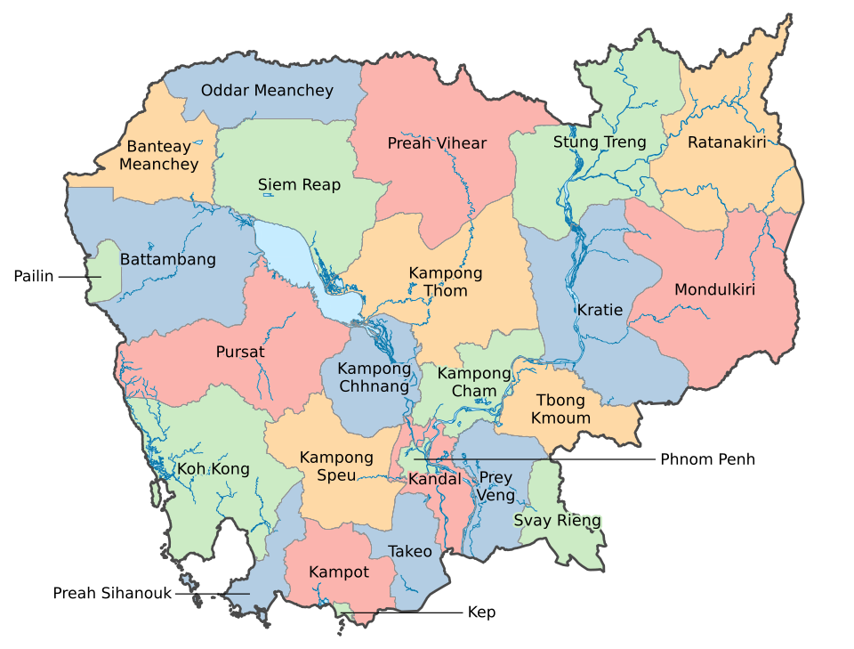

# 🇰🇭 Project-Map

An interactive web map project of Cambodia, organized by province. Start from the main page, pick a province, and explore its dedicated map page.



## 📖 About

**Project-Map** is a static, browser-based project that presents Cambodia's 25 provinces and municipalities. The home page (`Index.html`) shows an overview map of the country, and each province has its own HTML page along with a folder of related assets.

## ✨ Features

- Overview map of Cambodia on the home page
- A dedicated page for each province and municipality
- Per-province asset folders to keep content organized
- Pure HTML, so there is nothing to install or build

## 🗂️ Project Structure

```
Project-Map/
├── Index.html              # Home page (entry point)
├── Cambodia_map.png        # Overview map of Cambodia
├── SETEC LOGO PNG.png      # Logo
├── Logo/                   # Logo assets
├── Province/               # Shared province assets
│
├── BanteayMeanchey.html    # One HTML page per province...
├── Battambang.html
├── SiemReap.html
├── PhnomPenh.html
├── ...                     # (25 provinces/municipalities in total)
│
└── BateayMeanchey/         # One asset folder per province...
    Battambang/
    SiemReap/
    PhnomPenh/
    ...
```

## 📍 Provinces & Municipalities Covered

| | | | | |
|---|---|---|---|---|
| Banteay Meanchey | Battambang | Kampong Cham | Kampong Chhnang | Kampong Speu |
| Kampong Thom | Kampot | Kandal | Kep | Koh Kong |
| Kratie | Mondulkiri | Oddar Meanchey | Pailin | Phnom Penh |
| Preah Sihanouk | Preah Vihear | Prey Veng | Pursat | Ratanakiri |
| Siem Reap | Stung Treng | Svay Rieng | Takeo | Tboung Khmum |

## 🚀 Getting Started

### Option 1: Open locally

1. Clone the repository:
   ```bash
   git clone https://github.com/PheangBoranvirak/Project-Map.git
   cd Project-Map
   ```
2. Open `Index.html` in your web browser.

### Option 2: Run with a local server

Some browsers restrict local file access, so a simple server can help:

```bash
# Python 3
python -m http.server 8000
```

Then visit <http://localhost:8000/Index.html>.

### Option 3: Host on GitHub Pages

1. Go to **Settings → Pages** in your repository.
2. Under **Source**, choose the `main` branch and the `/ (root)` folder.
3. Save, and your site will be published at  
   `https://pheangboranvirak.github.io/Project-Map/Index.html`

> Note: GitHub Pages is case-sensitive, so the entry file is `Index.html` (capital "I").

## 🛠️ Built With

- HTML / CSS / JavaScript

## 🤝 Contributing

Contributions are welcome!

1. Fork the repository
2. Create a branch: `git checkout -b feature/your-feature`
3. Commit your changes: `git commit -m "Add your feature"`
4. Push to the branch: `git push origin feature/your-feature`
5. Open a Pull Request

## 👤 Author

**Pheang Boranvirak**  
GitHub: [@PheangBoranvirak](https://github.com/PheangBoranvirak)

## 📄 License

No license has been specified yet. You can add one (for example MIT) by creating a `LICENSE` file in the repository root.
